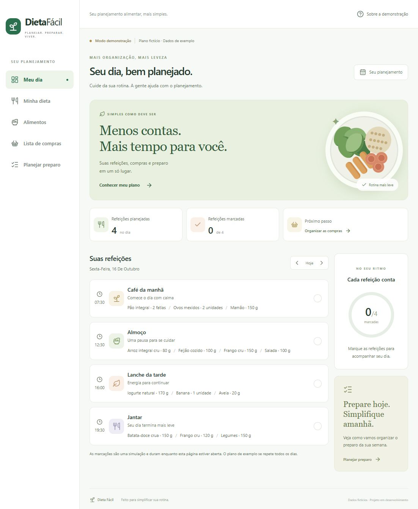

# Dieta Fácil

Planejamento alimentar que transforma um plano já definido em uma rotina de refeições, compras e preparo. Projeto de portfólio Full Stack construído em entregas pequenas e documentadas.

**Status: base local funcional.** Ainda não é o MVP completo. Os dados são fictícios e não constituem recomendação alimentar.



## Primeira entrega

- Interface em português, com navegação para computador e celular.
- Dashboard e plano de exemplo com quatro refeições vindas da API e do PostgreSQL.
- Marcação de refeições por dia, apenas em memória no navegador.
- Catálogo de itens do plano fictício.
- Páginas explicativas para compras e preparo, ainda sem cálculos.
- Migração Flyway, persistência JPA, teste de integração e verificação de saúde.

Não há autenticação, cadastro, edição nem isolamento por usuário nesta etapa. A API só oferece leitura de dados fictícios e escuta em loopback. Não utilizar com dados pessoais nem expor como aplicação de produção.

## Tecnologias

React 19, TypeScript, Vite 8, Tailwind CSS 4, React Router, TanStack Query e Lucide; Java 21, Spring Boot 4.1.1, Spring Data JPA, Flyway e PostgreSQL 17. Maven Wrapper incluído; Maven global não é necessário. H2 é usado somente nos testes automatizados.

## Executar no Windows

Pré-requisitos: Node.js LTS, Java/JDK 21 e PostgreSQL 17. Abra o PowerShell na pasta do repositório. Após instalar programas, abra um novo terminal para atualizar o PATH.

```powershell
# Instale as dependências uma vez.
cd frontend
npm.cmd ci
cd ..

# Crie/inicie o banco exclusivo do projeto na porta 5433.
powershell -ExecutionPolicy Bypass -File .\scripts\Start-Database.ps1

# Terminal 1: API Java
powershell -ExecutionPolicy Bypass -File .\scripts\Start-Backend.ps1

# Terminal 2: interface React
powershell -ExecutionPolicy Bypass -File .\scripts\Start-Frontend.ps1
```

Acesse **http://127.0.0.1:5173**. API: **http://127.0.0.1:8080/api/demo/schedule**. Saúde: **http://127.0.0.1:8080/actuator/health**.

O banco local e sua senha aleatória ficam em `.local/`, ignorado pelo Git. Os scripts não modificam a política de execução do computador; a opção Bypass vale somente para aquele processo. Para encerrar front-end e back-end, use Ctrl+C nos respectivos terminais. Para parar o banco:

```powershell
powershell -ExecutionPolicy Bypass -File .\scripts\Stop-Database.ps1
```

Alternativa com Docker instalado: copie `.env.example` para `.env`, defina sua senha, execute `docker compose up -d` e configure `DB_URL=jdbc:postgresql://localhost:5432/dieta_facil`, `DB_USER=dieta_facil` e `DB_PASSWORD` antes de iniciar a API. O arquivo `.env` não é carregado automaticamente pelo Spring. Não misture essa configuração com o cluster local na porta 5433.

## Validar

```powershell
cd frontend
npm.cmd run build
cd ..\backend
.\mvnw.cmd -B -ntp test
```

O teste verifica a migração, a leitura do plano fictício, a ordenação por horário e a sinalização dos dados de demonstração. O build verifica TypeScript e gera o pacote da interface. A integração com PostgreSQL também deve ser validada pela API local; H2 não substitui essa verificação.

## Organização e decisões

```text
frontend/     Interface React
backend/      API Java e migrações SQL
docs/         Arquitetura, API, decisões e diário de desenvolvimento
scripts/      Execução local no Windows
PROJECT_SPEC.md  Documento mestre
```

Veja [arquitetura](docs/ARCHITECTURE.md), [API](docs/API.md) e [diário](docs/DEVELOPMENT_LOG.md). O escopo completo está em [PROJECT_SPEC.md](PROJECT_SPEC.md).

Próxima entrega: definir autenticação por sessão/cookie HttpOnly e modelo definitivo de alimentos, planos e refeições, antes do CRUD pessoal. Compras e preparo ficam para a etapa de regras de negócio.
