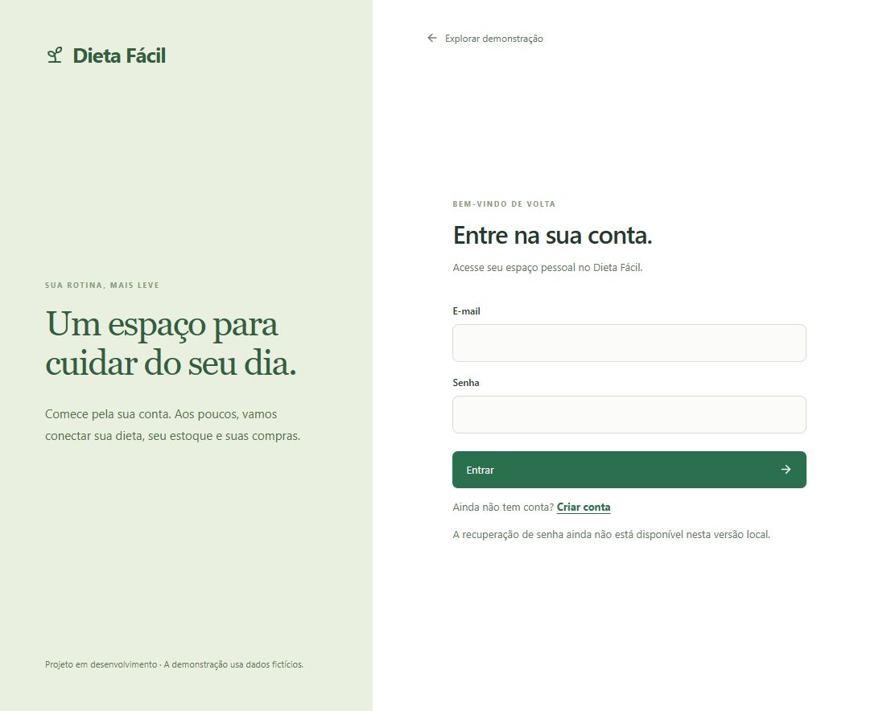
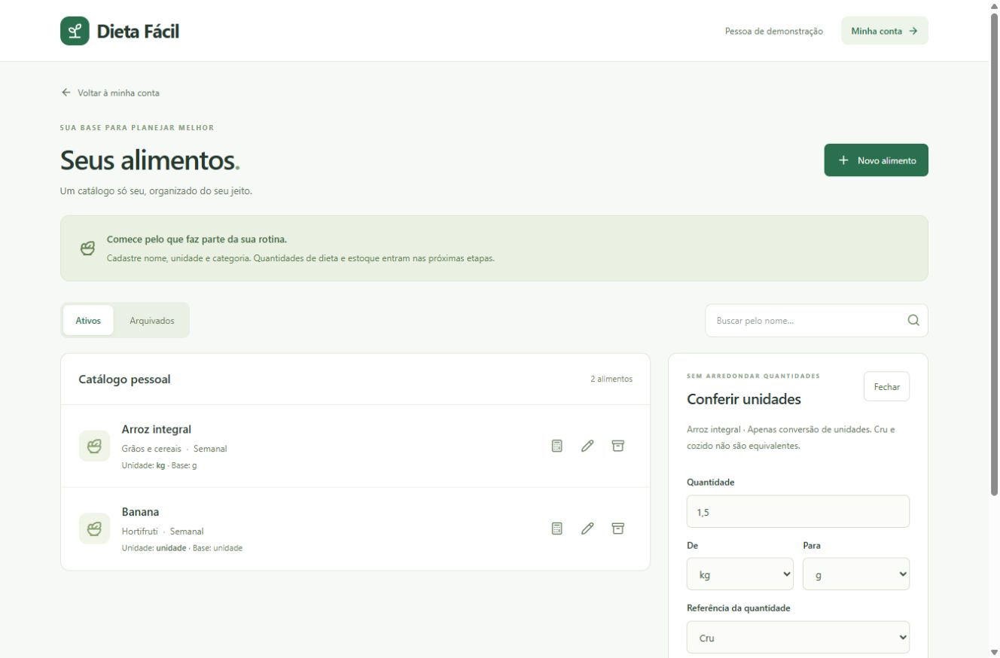

# Dieta Fácil

**Para continuar o desenvolvimento:** leia o [ponto de retorno](docs/RETOMADA.md). A próxima entrega é a E04.

Planejamento alimentar que transforma um plano já definido em uma rotina de refeições, compras e preparo. Projeto de portfólio Full Stack construído em entregas pequenas e documentadas.

**Status: base local funcional com acesso pessoal e catálogo de alimentos.** Ainda não é o MVP completo. Os dados são fictícios e não constituem recomendação alimentar.


## Primeira entrega

- Interface em português, com navegação para computador e celular.
- Dashboard e plano de exemplo com quatro refeições vindas da API e do PostgreSQL.
- Marcação de refeições por dia, apenas em memória no navegador.
- Catálogo de itens do plano fictício.
- Páginas explicativas para compras e preparo, ainda sem cálculos.
- Migração Flyway, persistência JPA, teste de integração e verificação de saúde.

A entrega E02 adiciona cadastro, login, logout e edição do próprio perfil, com sessão HttpOnly, CSRF e hash de senha. A demonstração continua pública e separada da conta. O catálogo pessoal já está implementado; dieta e estoque pessoais ainda não. Use dados de teste: recuperação de acesso e preparação para produção serão tratadas antes da abertura pública.

## Tecnologias

React 19, TypeScript, Vite 8, Tailwind CSS 4, React Router, TanStack Query e Lucide; Java 21, Spring Boot 4.1.1, Spring Data JPA, Flyway e PostgreSQL 17. Maven Wrapper incluído; Maven global não é necessário. H2 é usado somente nos testes automatizados.

## Executar no Windows

Pré-requisitos: Node.js LTS, Java/JDK 21 e PostgreSQL 17. Abra o PowerShell na pasta do repositório. Após instalar programas, abra um novo terminal para atualizar o PATH.

```powershell
# Instale as dependências uma vez.
cd frontend
npm.cmd ci
cd ..

# Crie/inicie o banco exclusivo do projeto na porta 5433.
powershell -ExecutionPolicy Bypass -File .\scripts\Start-Database.ps1

# Terminal 1: API Java
powershell -ExecutionPolicy Bypass -File .\scripts\Start-Backend.ps1

# Terminal 2: interface React
powershell -ExecutionPolicy Bypass -File .\scripts\Start-Frontend.ps1
```

Acesse **http://127.0.0.1:5173**. API: **http://127.0.0.1:8080/api/demo/schedule**. Saúde: **http://127.0.0.1:8080/actuator/health**.

O banco local e sua senha aleatória ficam em `.local/`, ignorado pelo Git. Os scripts não modificam a política de execução do computador; a opção Bypass vale somente para aquele processo. Para encerrar front-end e back-end, use Ctrl+C nos respectivos terminais. Para parar o banco:

```powershell
powershell -ExecutionPolicy Bypass -File .\scripts\Stop-Database.ps1
```

Alternativa com Docker instalado: copie `.env.example` para `.env`, defina sua senha, execute `docker compose up -d` e configure `DB_URL=jdbc:postgresql://localhost:5432/dieta_facil`, `DB_USER=dieta_facil` e `DB_PASSWORD` antes de iniciar a API. O arquivo `.env` não é carregado automaticamente pelo Spring. Não misture essa configuração com o cluster local na porta 5433.

## Validar

```powershell
cd frontend
npm.cmd run build
npm.cmd test
cd ..\backend
.\mvnw.cmd -B -ntp test
```

O teste verifica a migração, a leitura do plano fictício, a ordenação por horário e a sinalização dos dados de demonstração. O build verifica TypeScript e gera o pacote da interface. A integração com PostgreSQL também deve ser validada pela API local; H2 não substitui essa verificação.

## Organização e decisões

```text
frontend/     Interface React
backend/      API Java e migrações SQL
docs/         Arquitetura, API, decisões e diário de desenvolvimento
scripts/      Execução local no Windows
PROJECT_SPEC.md  Documento mestre
```

Veja [arquitetura](docs/ARCHITECTURE.md), [API](docs/API.md) e [diário](docs/DEVELOPMENT_LOG.md). O escopo completo está em [PROJECT_SPEC.md](PROJECT_SPEC.md).

O planejamento foi revisado para incluir estoque, lotes, reposição por cobertura e validade informada no MVP. Esses recursos ainda não estão implementados. Consulte [plano de evolução](docs/ROADMAP.md), [regras de estoque e compras](docs/INVENTORY_RULES.md), [modelo de domínio](docs/DOMAIN_MODEL.md) e [decisão de autenticação](docs/decisions/ADR-001-auth-and-modules.md).

Próxima entrega: E04 — dieta manual e agenda recorrente. Depois: estoque, compras, consumo/preparo e alertas. A aplicação não usará IA para calcular quantidades ou estimar prazos de conservação.

## Acesso pessoal (E02)

Abra `/cadastro` para criar uma conta de teste, depois `/entrar` para autenticar. `/conta` permite alterar nome e fuso horário ou sair. O e-mail não é editável nesta entrega. Senha: mínimo de 10 caracteres, máximo de 72 bytes UTF-8 (limite do BCrypt). A API aceita fusos reconhecidos pelo Java, por exemplo America/Sao_Paulo.

A sessão expira após 30 minutos sem atividade e é perdida ao reiniciar o back-end. Em produção, ativar o perfil `prod` e servir por HTTPS: o cookie passa a exigir Secure. Isso ainda não é uma implantação de produção, nem um sistema completo de gestão de contas (sem recuperação de senha/verificação de e-mail nesta etapa).



Validação E02: seis testes Java no fluxo padrão, cinco testes de interface e quatro testes HTTP de autenticação executados também no PostgreSQL local. Os testes de interface usam respostas simuladas; os testes Java iniciam servidor HTTP real. O teste do cookie de produção verifica os atributos Secure/HttpOnly/SameSite, sem simular um deploy TLS. Login, edição e logout foram conferidos no navegador; cadastro foi exercitado pelos testes HTTP e de interface. Layout de cadastro revisado em viewport de 390 pixels, sem teste em aparelho físico.
## Catálogo pessoal (E03)

Após entrar, abra `/conta/alimentos` ou use o atalho do perfil. Você pode cadastrar alimentos, definir categoria/frequência/unidade, buscar pelo nome, editar, arquivar e restaurar. O catálogo começa vazio; os exemplos da demonstração não são importados automaticamente.

Arquivamento preserva o cadastro; não há exclusão definitiva. A dimensão do alimento não pode mudar após criação, mas a unidade pode mudar de kg para g ou de L para ml. O conversor aceita vírgula decimal, preserva referência cru/cozido/como vendido e não altera estoque. Contagem aceita somente inteiros. Catálogo de alimentos não significa quantidade disponível em casa.



Contrato e regras em [FOODS_API.md](docs/FOODS_API.md). Validação E03: 13 testes Java e 11 testes de interface passaram; os 7 testes de alimentos/conversões também passaram em PostgreSQL 17 local. Build de produção aprovado. No navegador, cadastro, arquivamento/restauração e conversão foram conferidos com conta fictícia. Catálogo e formulário revisados em largura de 390 px, sem teste em aparelho físico.
