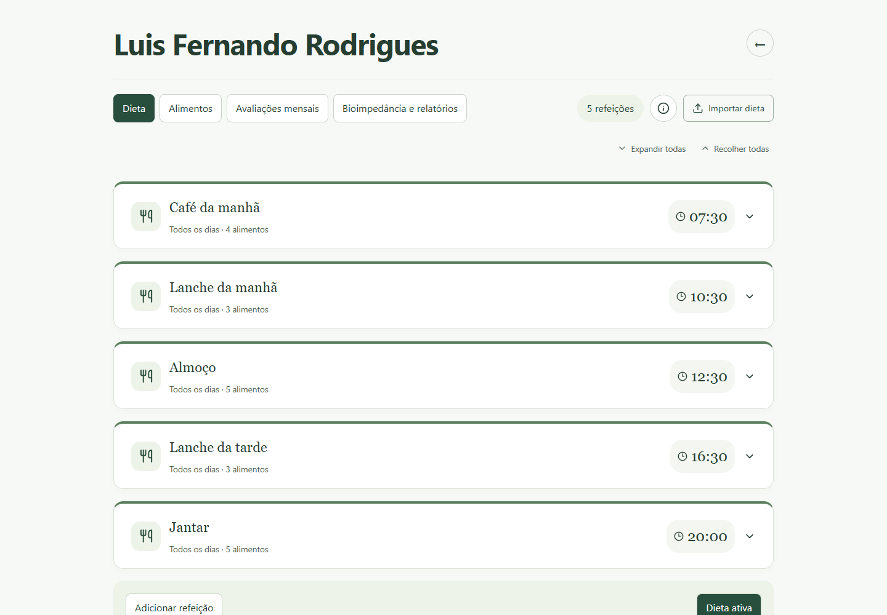
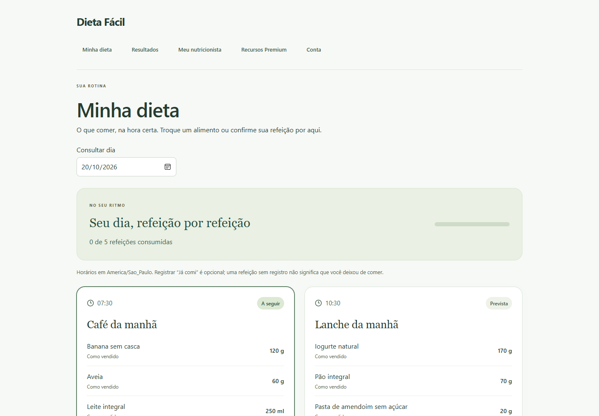
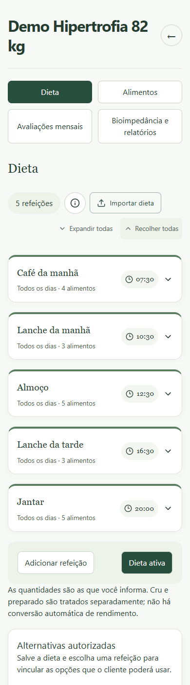
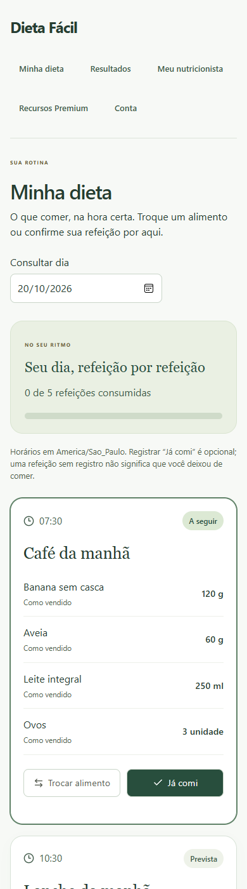
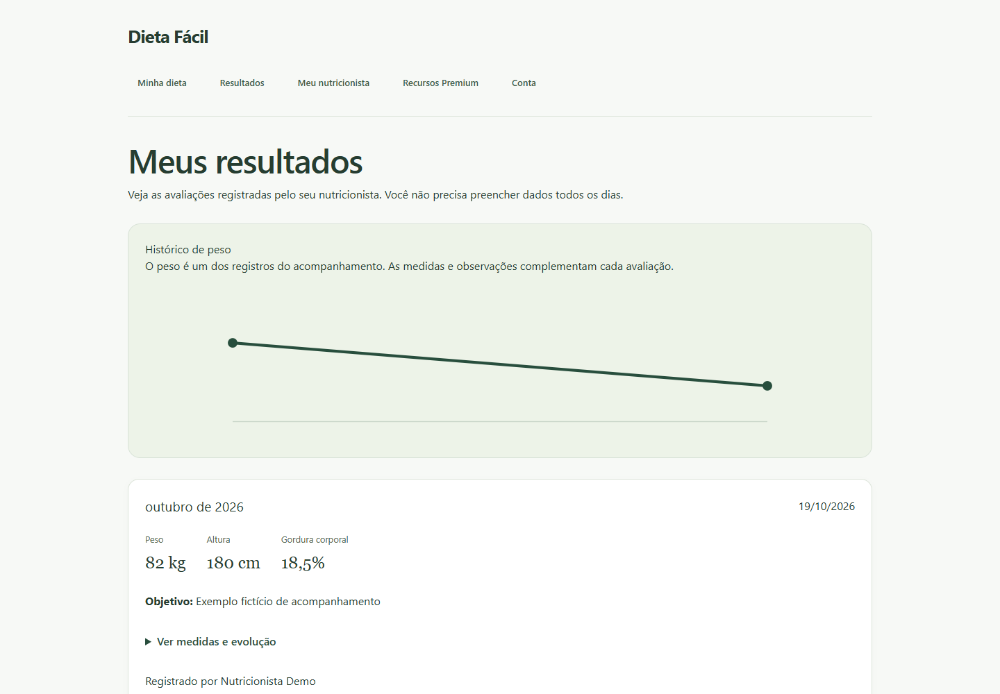

# Dieta Fácil

[](https://github.com/LuisFernandoRodriguesDePaula/dieta-facil/actions/workflows/ci.yml)

Aplicativo Full Stack de acompanhamento alimentar: o nutricionista prepara a dieta e registra avaliações; o cliente consulta refeições, alternativas autorizadas e resultados. Interface em português para computador e celular, com React/TypeScript, Java 21/Spring Boot e PostgreSQL.

**Versão 1.0 em avaliação, com dados fictícios.** O fluxo principal está implementado e validado por testes automatizados. A demonstração foi disponibilizada aos nutricionistas; o primeiro feedback recebido solicita nutrientes e totais por refeição. Existe compartilhamento temporário por HTTPS para revisão; a hospedagem permanente ainda não foi ativada. Este projeto não está apresentado como sistema clínico pronto para pacientes reais.

## Próxima evolução: acompanhamento e atendimento assistido

O [plano de evolução](docs/EVOLUCAO_PRODUTO.md) organiza nutrientes com cálculo determinístico, atendimento IA supervisionado com contexto da dieta, check-ins, CRM/jornada, agenda, financeiro, equipes e comunicação. Inspiração funcional na Wellts, identidade própria e direção visual branca/verde-água. Esses recursos são **planejados**, não funcionalidades disponíveis nesta versão.

Documentos: [arquitetura da IA](docs/AI_ASSISTANT.md), [nutrientes](docs/NUTRIENTES.md), [direção visual](docs/DESIGN_SYSTEM.md), [feedback e dúvidas](docs/FEEDBACK_EVOLUCAO.md) e [ADR-003](docs/decisions/ADR-003-acompanhamento-e-ia.md). A estrutura de acompanhamento, os nutrientes e a caixa de dúvidas preparam um piloto de IA antes dos módulos de gestão mais amplos.

## Experiência dos dois perfis

| Nutricionista | Cliente |
|---|---|
| Convida e acompanha clientes após aceite | Aceita ou revoga o acompanhamento |
| Monta dieta com horários, dias e porções | Consulta as refeições em ordem de horário |
| Define alternativas e permite/bloqueia trocas | Escolhe apenas alternativas autorizadas para a refeição |
| Consulta versões e aplica a dieta para hoje | Vê a dieta vigente, sem editor de prescrição |
| Registra peso, medidas opcionais e objetivo por mês | Consulta histórico, medidas e variações |

### Acompanhamento profissional

Refeições recolhidas, edição por cartão, atalhos semanais e estado de dieta ativa confirmado pelo servidor.



### Consulta do cliente

Horários, alimentos e porções; registrar Já comi é opcional e pode ser desfeito por refeição.



<details>
<summary>Ver as telas no celular</summary>




Capturas em viewport de 390 pixels. Não substituem conferência em aparelho físico.

</details>

<details>
<summary>Ver o histórico de avaliações</summary>



Peso, altura, gordura corporal e objetivo no resumo; cintura, braço, coxa, panturrilha, quadril e comparação com a avaliação anterior ao expandir. Valores são informados pelo profissional, sem interpretação clínica ou cálculo automático de gordura.

</details>

As imagens mostram contas fictícias da cópia isolada de revisão. Não incluem senhas, endereço temporário ou dados de pacientes.

## Básico e recursos opcionais

O Básico oferece dieta e acompanhamento sem movimentar estoque. Premium acrescenta controle opcional de estoque, compras e preparo, com ativação explícita e saldos preservados. Não há contratação nem cobrança implementada.

Os módulos opcionais incluem lotes/validade, projeção de faltas até a próxima compra, recebimentos parciais e preparo de cru para preparado sem baixa duplicada. Não são necessários para o cliente consultar a dieta.

## Decisões técnicas

- Autorização pelo vínculo profissional ativo, além da proteção das rotas. O cliente não escreve a própria prescrição nem as avaliações.
- Dietas com vigência e snapshots de ocorrências; refeições já registradas preservam seu histórico.
- Versão nas gravações para rejeitar conflitos entre janelas, com recuperação explícita na interface.
- Registro de refeição separado da baixa de estoque; desativar o controle preserva saldos e não gera consumo retroativo.
- Quantidades com BigDecimal, transações e bloqueio por conta, repetição segura e estornos.
- Sessão HttpOnly, CSRF e senhas BCrypt; recuperação, confirmação de e-mail e exclusão de conta.
- API e interface compilada servidas na mesma origem; pacote Docker validado pela CI.

## Experimentar e avaliar

- [Entrega da versão 1.0](docs/ENTREGA_V1.md): execução e demonstração local dos dois perfis.
- [Roteiro de validação](docs/V1_VALIDATION.md) e [ficha de feedback](docs/FEEDBACK_V1.md).
- [Revisão temporária remota](docs/DESIGN_REVIEW.md): cópia isolada, com banco e contas fictícias próprios. Link e credenciais ficam privados; o computador precisa continuar ligado e o link expira.
- [Publicação permanente preparada](docs/DEPLOYMENT.md): ainda depende das contas externas e da validação do ambiente real.

Não existe um botão público de demonstração permanente neste momento. O endereço temporário não é colocado no README porque muda e expira. Para um novo avaliador executar o projeto, siga as instruções abaixo.

## Executar no Windows

Pré-requisitos: Node.js LTS, JDK 21 e PostgreSQL 17. Abra o PowerShell na pasta do repositório, atualmente chamada **Dieta Fácil**.

```powershell
# Dependências da interface, na primeira execução:
cd frontend
npm.cmd ci
cd ..

# Banco exclusivo do projeto:
powershell -ExecutionPolicy Bypass -File .\scripts\Start-Database.ps1

# Terminal 1:
powershell -ExecutionPolicy Bypass -File .\scripts\Start-Backend.ps1

# Terminal 2:
powershell -ExecutionPolicy Bypass -File .\scripts\Start-Frontend.ps1
```

Abra [Dieta Fácil local](http://127.0.0.1:5173/conta/inicio). Ao entrar, você será encaminhado ao painel correspondente ao seu perfil. Para experimentar o exemplo funcional, carregue o cenário fictício em uma conta vazia.

A API usa 8080; o PostgreSQL local usa 5433. Senha aleatória e dados ficam em .local/, ignorado pelo Git. A opção Bypass vale somente para o processo do script. Para encerrar interface/API, use Ctrl+C nos respectivos terminais; para parar o banco, execute scripts/Stop-Database.ps1.

Alternativa com Docker: copie .env.example para .env, defina sua senha, inicie docker compose e exporte DB_URL, DB_USER e DB_PASSWORD antes de executar a API. O Spring não lê .env automaticamente. Não misture o banco Docker em 5432 com o cluster local em 5433.

## Validar

```powershell
cd frontend
npm.cmd run build
npm.cmd test
npm.cmd run lint

# Com a API e a interface locais já iniciadas:
npm.cmd run test:e2e

cd ..\backend
.\mvnw.cmd -B -ntp test
```

Playwright usa o Edge instalado por padrão. Para Chromium, instale-o com npx playwright install chromium e defina PLAYWRIGHT_CHANNEL=chromium. O teste cria contas fictícias novas e captura telas em .local/screenshots.

A CI executa build, lint, testes de interface, testes Java em H2 e PostgreSQL e a jornada no navegador. Quantidades usam BigDecimal; operações de saldo são transacionais e idempotentes. Há testes de autorização, CSRF, validade por dia, repetição, estorno e concorrência. Detalhes e limites reais estão no [diário de desenvolvimento](docs/DEVELOPMENT_LOG.md).

## Organização

```text
frontend/        React, TypeScript, Vite, interface e testes de navegador
backend/         Spring Boot, domínio, API e migrações Flyway
docs/            Regras, decisões, contratos e roteiro
scripts/         Execução local no Windows
PROJECT_SPEC.md  Especificação e visão de evolução
```

Consulte [arquitetura](docs/ARCHITECTURE.md), [API](docs/API.md), [regras de estoque](docs/INVENTORY_RULES.md), [roadmap](docs/ROADMAP.md) e [ponto de retorno](docs/RETOMADA.md).

## Limites desta versão

Recuperação, confirmação de e-mail e exclusão estão implementadas. Na execução local, os links ficam em .local/mail; envio real requer configuração do provedor. Publicação permanente, TLS na hospedagem definitiva, entrega real de e-mail e backup externo aguardam ativação e validação. O túnel de revisão já usa HTTPS, mas é temporário. Sessões expiram após 30 minutos sem atividade e são perdidas ao reiniciar a API.

Cru, preparado e como vendido permanecem separados. Rendimento e validade são informados explicitamente; não há estimativa por IA. Receitas compostas, importação de dieta, nutrientes e embalagens/arredondamento comercial ficam para evolução posterior. O cálculo não reserva estoque. O histórico da tela mostra as 100 operações mais recentes, preservadas integralmente no banco.

O perfil profissional é autodeclarado. Identidade profissional, auditoria e operação/retenção de dados ainda precisam de definição antes de pacientes reais. Importações e bioimpedância permanecem como campos reservados desativados. Não há chamada de API de IA, hospedagem contratada ou serviço pago na aplicação.
