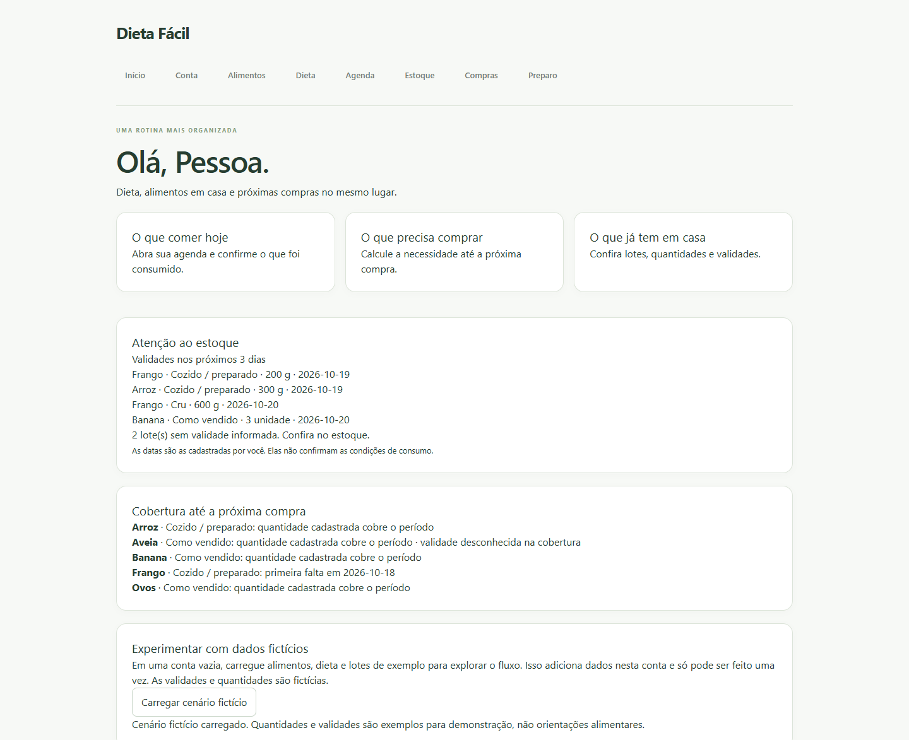

# Dieta Fácil

Aplicativo de planejamento alimentar que conecta uma dieta já definida ao estoque doméstico, às compras e ao preparo. Interface em português para computador e celular, com React, Java/Spring Boot e PostgreSQL.

**Versão demonstrável local.** O fluxo pessoal já funciona: cadastro → catálogo → dieta → agenda → estoque → compras → preparo e consumo. A demonstração usa dados fictícios e não prescreve alimentação. Publicação e integração com o projeto Portfólio ficam para uma etapa posterior.



## O que funciona

- Conta com sessão HttpOnly, CSRF, senha BCrypt e dados separados por usuário.
- Catálogo pessoal, busca, arquivamento e conversões exatas de unidades.
- Dieta com revisões por data, refeições recorrentes e agenda no fuso do perfil.
- Estoque por lotes, com quantidade, validade, origem da data e armazenamento; conferência conhecida, parcial ou desconhecida.
- Compras calculadas por dia, considerando os lotes pela validade mais próxima, com listas salvas, ajustes e recebimentos parciais.
- Ciclo semanal ou mensal salvo na conta, com dia configurável e período manual para o cálculo.
- Preparo medido de cru para preparado, consumo confirmado e estornos sem saldo negativo ou baixa duplicada.
- Painel de cobertura até a próxima compra e de validades próximas/desconhecidas.
- Carga opcional de cenário fictício em conta vazia, sem sobrescrever dados existentes.

O [roteiro da demonstração](docs/DEMO_GUIDE.md) explica como experimentar cada etapa.

## Executar no Windows

Pré-requisitos: Node.js LTS, JDK 21 e PostgreSQL 17. Abra o PowerShell na pasta do repositório, atualmente chamada **Dieta Fácil**.

```powershell
# Dependências da interface, na primeira execução:
cd frontend
npm.cmd ci
cd ..

# Banco exclusivo do projeto:
powershell -ExecutionPolicy Bypass -File .\scripts\Start-Database.ps1

# Terminal 1:
powershell -ExecutionPolicy Bypass -File .\scripts\Start-Backend.ps1

# Terminal 2:
powershell -ExecutionPolicy Bypass -File .\scripts\Start-Frontend.ps1
```

Abra [Dieta Fácil local](http://127.0.0.1:5173/conta/inicio). Crie uma conta, entre e use **Abrir meu painel** no perfil. Para experimentar o exemplo funcional, carregue o cenário fictício em uma conta vazia.

A API usa 8080; o PostgreSQL local usa 5433. Senha aleatória e dados ficam em .local/, ignorado pelo Git. A opção Bypass vale somente para o processo do script. Para encerrar interface/API, use Ctrl+C nos respectivos terminais; para parar o banco, execute scripts/Stop-Database.ps1.

Alternativa com Docker: copie .env.example para .env, defina sua senha, inicie docker compose e exporte DB_URL, DB_USER e DB_PASSWORD antes de executar a API. O Spring não lê .env automaticamente. Não misture o banco Docker em 5432 com o cluster local em 5433.

## Validar

```powershell
cd frontend
npm.cmd run build
npm.cmd test
npm.cmd run lint

# Com a API e a interface locais já iniciadas:
npm.cmd run test:e2e

cd ..\backend
.\mvnw.cmd -B -ntp test
```

Playwright usa o Edge instalado por padrão. Para Chromium, instale-o com npx playwright install chromium e defina PLAYWRIGHT_CHANNEL=chromium. O teste cria contas fictícias novas e captura telas em .local/screenshots.

A CI executa build, lint, testes de interface, testes Java em H2 e PostgreSQL e a jornada no navegador. Quantidades usam BigDecimal; operações de saldo são transacionais e idempotentes. Há testes de autorização, CSRF, validade por dia, repetição, estorno e concorrência. Detalhes e limites reais estão no [diário de desenvolvimento](docs/DEVELOPMENT_LOG.md).

## Organização

```text
frontend/        React, TypeScript, Vite, interface e testes de navegador
backend/         Spring Boot, domínio, API e migrações Flyway
docs/            Regras, decisões, contratos e roteiro
scripts/         Execução local no Windows
PROJECT_SPEC.md  Especificação e visão de evolução
```

Consulte [arquitetura](docs/ARCHITECTURE.md), [API](docs/API.md), [regras de estoque](docs/INVENTORY_RULES.md), [roadmap](docs/ROADMAP.md) e [ponto de retorno](docs/RETOMADA.md).

## Limites desta versão

Sem recuperação de senha, verificação de e-mail, exclusão de conta ou preparação completa para abertura pública. Sessões expiram após 30 minutos sem atividade e são perdidas ao reiniciar a API.

Cru, preparado e como vendido permanecem separados. Rendimento e validade são informados explicitamente; não há estimativa por IA. Receitas compostas, importação de dieta, nutrientes e embalagens/arredondamento comercial ficam para evolução posterior. O cálculo não reserva estoque. O histórico da tela mostra as 100 operações mais recentes, preservadas integralmente no banco.

Não há chamada de API de IA, hospedagem contratada ou serviço pago na aplicação.
