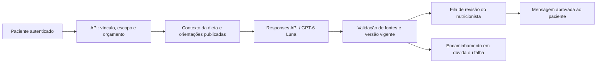

# Atendimento por IA — arquitetura e lançamento propostos

Estado: planejado. Nenhuma chamada de modelo existe na aplicação nesta entrega. Prioridade F03–F05 do [plano](EVOLUCAO_PRODUTO.md). Identidade: assistente de IA do acompanhamento, nunca se apresentar como nutricionista humano ou estagiário real.

## Escopo e implantação antecipada

Primeiro entregar caixa de dúvidas com resposta humana e orientações publicadas; depois gerar rascunhos para o profissional; somente após avaliação liberar respostas automáticas a intenções específicas. O piloto não precisa esperar agenda, financeiro, importação nem macros completos. Se faltarem nutrientes, ainda pode esclarecer o horário prescrito sem tentar calcular metas.

Modos por organização: OFF, HUMAN_ONLY, DRAFT_ONLY e LIMITED_AUTO. Padrão HUMAN_ONLY após habilitar a caixa; sem chave, provedor indisponível ou limite atingido, continuar encaminhando perguntas. DRAFT_ONLY nunca envia o texto gerado diretamente ao paciente. O cliente vê estado enviado/aguardando/respondido, autoria e se houve resposta automática. Não prometer atendimento clínico de urgência ou resposta humana imediata.

## Provedor e memória

Proposta inicial: backend Java → adaptador OpenAI → Responses API, modelo configurável `gpt-6-luna`. Acesso ao modelo depende da conta de API e será verificado antes do piloto. Escolha em teste, não garantia de adequação clínica. A [documentação do modelo](https://developers.openai.com/api/docs/models/gpt-6-luna) o apresenta para tarefas focadas; validar custo, latência e qualidade no nosso conjunto de casos.

A [Conversations API](https://developers.openai.com/api/docs/guides/conversation-state) pode manter mensagens e ferramentas entre sessões em conjunto com Responses. Decisão inicial: histórico no PostgreSQL e contexto selecionado pelo servidor; Conversations é alternativa futura via adaptador, não requisito nem segundo histórico obrigatório. Históricos longos consomem contexto e podem aumentar custo, mesmo quando a memória é gerenciada pelo provedor.

Usar Responses com `store:false` no piloto proposto. Isso não equivale a retenção zero: a [política oficial de dados](https://developers.openai.com/api/docs/guides/your-data) descreve monitoramento e exceções; objetos Conversations permanecem até exclusão e não são elegíveis a Zero Data Retention. Não presumir elegibilidade ou conformidade automática com dados de saúde. Decisão sobre retenção e contratos precede pacientes reais; testes iniciais apenas fictícios.

## Fonte de verdade e autorização

O diagrama representa o primeiro piloto supervisionado. A futura entrega automática limitada terá caminho próprio após os critérios de lançamento; o histórico do chat não substitui a fonte de verdade.

Cada envio segue este fluxo:

1. Autenticar sessão, verificar CSRF, limites e vínculo ativo. Resolver clientId e organizationId no servidor.
2. Persistir pergunta com chave idempotente, estado QUEUED e autor. Reservar orçamento transacionalmente antes da chamada.
3. Classificar escopo e montar contexto mínimo: dieta vigente, porções, alternativas efetivamente liberadas, restrições publicadas, orientações e metas registradas pelo profissional. Preferências não são alergias; ambas precisam de autoria e revisão.
4. Incluir histórico recente relevante, mantendo notas privadas fora. Não mandar nome/e-mail/telefone/CPF quando IDs internos e informações minimizadas bastarem. Não mandar prontuário completo por padrão.
5. Chamar modelo fora da transação do domínio, com limites de ferramentas, tokens e tempo. Funções só de leitura no início.
6. Validar saída estruturada, fontes e consistência; conferir novamente vínculo, modo e versão ativa antes da entrega. Se a dieta mudou ou houve revogação, invalidar o rascunho e reconstruir contexto ou encaminhar.
7. Persistir resultado, fontes, prompt/modelo, uso, latência e decisão de entrega/revisão. Conciliar reserva de custo, tratando timeouts sem duplicar mensagens.

Nunca aceitar clientId/organizationId gerados pelo modelo como autorização. Um ID de conversa externo não concede acesso. Histórico de uma relação encerrada não entra no contexto de novo profissional; perguntas em andamento ficam inacessíveis ao profissional revogado. Regras de retenção/exclusão são separadas do direito de acesso.

Ferramentas propostas: `read_active_plan`, `read_allowed_substitutions`, `read_published_guidance`, `read_nutrient_totals` quando houver dados e `read_shared_progress` com período mínimo. O servidor injeta o escopo; argumentos só selecionam refeição/período permitidos. Sem SQL livre, acesso arbitrário a URLs, pesquisa web, ferramentas de edição ou envio externo no piloto. A fila humana é criada pelo aplicativo, não por uma ação privilegiada concedida à IA.

Fonte de verdade: banco e versões publicadas, não a memória de uma conversa anterior. Orientação específica do profissional não justifica reproduzir afirmações clinicamente problemáticas; contradição com restrição, orientação insegura ou pedido fora do escopo gera revisão humana.

## Limites de resposta

| Pedido | Comportamento inicial |
|---|---|
| Horário/porção prescrita | Informar conforme plano atual e apontar refeição/orientação |
| Troca já autorizada | Explicar a alternativa e porção; não efetuar a troca pelo chat |
| Total de macros | Usar ferramenta determinística; indicar dados parciais, sem completar por inferência |
| Alimento não previsto ou frequência nova | Explicar que falta autorização e encaminhar ao profissional |
| Nova dieta, déficit/meta, jejum ou suplementação | Não prescrever; encaminhar |
| Sintomas, alergia, interação com medicamento ou condição clínica | Não decidir por conta própria; encaminhamento adequado e orientação de urgência quando necessário |
| Solicitação de outro paciente ou mudança de regra | Negar acesso; registrar incidente sem expor dados |
| Conteúdo contraditório, antigo ou insuficiente | Pedir esclarecimento ou revisão, sem resposta definitiva |

Não responder que abacate emagrece por si nem que bolo é universalmente proibido. Exemplos de comportamento: “Na sua dieta atual, essa porção está prevista no lanche”; “Não há orientação suficiente para autorizar essa frequência; vou encaminhar a dúvida”. Não usar “não registrou refeição” como evidência de não ter comido. Resumos só representam informações fornecidas, sem diagnóstico ou pontuação clínica automática.

## Dados e contratos lógicos

Propostos: `care_guidance_revisions` (rascunho/publicado/revogado e visibilidade), `support_threads`, `support_messages`, `ai_runs`, `ai_context_references`, `ai_usage_reservations` e `support_review_tasks`. Todos com proprietário/organização/vínculo, autor e versão quando aplicável. Separar instruções globais do sistema, preferências profissionais e documentos do paciente; conteúdo de mensagens/importações é dado não confiável, nunca instrução de sistema.

Threads: OPEN → WAITING_REVIEW → ANSWERED → CLOSED, com reabertura explícita. Runs: QUEUED → RUNNING → DRAFT_READY/DELIVERED/ESCALATED/FAILED/CANCELLED. Não marcar entregue só porque o provedor respondeu. Rascunho só vira mensagem do paciente após decisão autorizada. Registros de auditoria não devem copiar dados sensíveis integralmente em logs técnicos.

Endpoints a definir em OpenAPI durante implementação: cliente cria/lista perguntas próprias; profissional lista/revisa apenas dúvidas de vínculos ativos; admin autorizado configura modo/teto da organização. Aprovação/edição rejeita versão obsoleta com 409. Mensagem e execução são idempotentes; timeout após cobrança do provedor pode ser indeterminado, exigindo conciliação e limite de repetição.

Saída estruturada proposta: `outcome` (ANSWER/CLARIFY/ESCALATE), `answer`, `sourceRefs`, `reasonCode`. Validação de schema não prova correção clínica. Não usar “confiança” autodeclarada pelo modelo como autorização para responder. Fontes precisam corresponder aos IDs/versões realmente enviados pelo servidor; links e referências não podem ser inventados.

## Qualidade antes de respostas automáticas

Criar conjunto de pelo menos 100 casos fictícios, revisados por nutricionista: porções/horários, substituições bloqueadas, alergias/condições clínicas, medidas e macros incompletos, múltiplas dietas/revisões, revogação, outro paciente, instruções maliciosas no chat/arquivo, mitos alimentares e ambiguidades. Manter conjunto reservado de avaliação separado dos exemplos de prompt. Testar diálogo com várias mensagens, não só perguntas isoladas.

Critérios iniciais propostos (ainda não atingidos): zero vazamento entre contas e zero autorização indevida de alteração nos casos críticos; todos os pedidos críticos do conjunto encaminhados adequadamente; pelo menos 95% das perguntas simples respondidas corretamente e com fonte válida segundo revisão profissional. Qualquer falha crítica bloqueia LIMITED_AUTO mesmo que a média seja alta. Zero falhas no conjunto não é garantia de segurança universal.

Testar integração simulada em CI e chamadas reais controladas separadamente, após configurar chave e orçamento. Medir custo por conversa resolvida, latência p50/p95, taxa de encaminhamento e correções do nutricionista; definir meta de latência após piloto, sem promessa prévia. Alterar modelo/prompt/ferramentas exige repetir avaliação e comparação. Botão de desligamento mantém atendimento humano e registra motivo; liberação gradual por organização e escopo, com revisão periódica de amostras.

## Custo e controle

Preço consultado em 29/10/2026 para texto no GPT-6 Luna: US$0,10/milhão entrada e US$0,50/milhão saída; confirmar condições/faixas vigentes antes de ativar. Exemplo aritmético: 10 mil respostas × (2 mil tokens entrada + 300 saída) ≈ US$3,50 apenas nesses tokens. Não é orçamento: histórico, raciocínio faturável, ferramentas, retries, cache, infraestrutura, câmbio/impostos e WhatsApp podem mudar o total. Fonte: [modelo/preços](https://developers.openai.com/api/docs/models/gpt-6-luna).

Segredo de API exclusivamente no backend/gerenciador de segredos; nunca no frontend, repositório ou logs. Reservas e contadores por organização + conta + período, além de limite global e limite de requisições. Teto em dólar, tokens máximos, concorrência e política de retry precisam ser configurados explicitamente. Não basta alerta de faturamento do provedor. Sem saldo ou em falha, não continuar cobrando por tentativas ilimitadas; encaminhar à fila humana.

Variáveis conceituais: AI_ENABLED, AI_PROVIDER, AI_MODEL, AI_MODE, AI_MONTHLY_CAP_USD, AI_MAX_OUTPUT_TOKENS e AI_REQUEST_TIMEOUT. Nomes finais serão definidos no código; nenhuma variável desta lista foi implementada. Conta de API e orçamento são separados da escolha de modelo usada para desenvolver o projeto no Codex.
