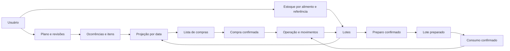

# Modelo de domínio para as próximas entregas

Planejado em 2026-10-16; não representa tabelas já implementadas. Criar migrações apenas na entrega correspondente. `demo_meals` permanece isolada e nunca vira dados pessoais automaticamente.

Estado atual — 2026-10-18: V2 users; V3 foods; V4 diet_plans, plan_revisions, plan_meals, meal_days, plan_items e meal_occurrences; V5 inventory_accounts, inventory_lots, inventory_operations e inventory_movements; V6 shopping_lists e shopping_receipts; V7 demo_scenarios; V8 shopping_preferences. O modelo abaixo preserva a visão conceitual; nomes/colunas efetivos estão nas migrações. Snapshots de ocorrência/lista e pedidos de operação são JSON em TEXT.

## Estrutura

| Agregado/tabelas previstas | Responsabilidade e campos principais |
|---|---|
| users | Nome, e-mail normalizado único, hash de senha, timezone, datas |
| shopping_preferences | user_id único, ciclo semanal/mensal/manual, weekday ou day_of_month, janela de alertas |
| foods | Dono, nome, dimensão/base_unit, categoria, frequência, archived_at |
| food_packages | Alimento, conteúdo na unidade base; opcional para arredondar compra |
| meal_plans / plan_revisions | Dono, nome, revisão e vigência sem sobreposição de planos ativos |
| meals / meal_days / meal_items | Revisão, nome, horário local, dias 1–7, alimento, quantidade e referência |
| meal_occurrences / occurrence_items | Revisão e snapshot de itens por data; estado pendente/consumida/pulada; unicidade usuário+refeição lógica+data, independente da revisão |
| inventory_accounts | Dono, alimento, referência, conhecimento KNOWN/UNKNOWN/PARTIAL e data de conferência |
| inventory_lots | Dono, alimento, referência, saldo NUMERIC(19,6), local, estado, validade/origem, abertura/preparo, versão |
| stock_operations | Dono, tipo, chave de idempotência, hash de payload, resultado persistido, origem, instante/data local, reversão |
| stock_movements | Operação, lote, delta assinado na unidade base, motivo; imutável |
| shopping_lists / shopping_list_items | Intervalo, snapshot/versionamento de cálculo, estado, demanda, alocação, falta, ajuste, sugestão e compra efetiva |
| shopping_allocations | Item da lista, ocorrência e lote considerado na projeção; quantidade e motivo de incerteza; não reserva saldo |
| purchase_receipts / purchase_receipt_items | Operação de recebimento, lista opcional, quantidade real por item, lotes resultantes |
| preparation_batches / preparation_inputs / preparation_outputs | Operação de transformação, entradas por lote e saídas preparadas com quantidade explícita |

Diagrama conceitual simplificado (não é um esquema SQL):

## Integridade

- Dono obtido da sessão, nunca aceito do corpo da requisição como fonte de autorização. Relações entre agregados devem pertencer à mesma conta.
- Usar chaves estrangeiras e, quando aplicável, chaves compostas com user_id para impedir referências cruzadas. Testar APIs com duas contas e IDs reais.
- CHECK de quantidade positiva nos itens e saldo não negativo nos lotes; quantidade zero é permitida no saldo e na conferência de estoque, não em movimentação.
- NUMERIC(19,6) é uma proposta de precisão: validar limites de entrada/overflow e definir arredondamento de exibição sem arredondar saldos silenciosamente. Java usa BigDecimal.
- Consumir em transação com bloqueio dos lotes e atualização de versão; lock em ordem estável. Testar concorrência em PostgreSQL real.
- Unicidade de stock_operations por (user_id, operation_type, idempotency_key). Uma operação contém todos os movimentos e o resultado; não gravar idempotência fora da transação de negócio.
- Histórico referencia snapshots de quantidades/itens. Edição de plano cria revisão vigente, sem mudar ocorrência já confirmada. Impedir confirmação duplicada mesmo quando uma ocorrência é regenerada por revisão: chave lógica de execução preservada na edição.
- Conferência de estoque ajusta o saldo por movimento; não sobrescreve o histórico. PARTIAL permite lotes conhecidos com quantidade adicional não conferida.
- Saldos materializados devem ser iguais à soma de movimentos por lote, inclusive inicialização, descartes e estornos. Guardar verificações de reconciliação nos testes de integração.
- Arquivar alimentos/planos com histórico; não executar cascata destrutiva. Gestão de exclusão de conta será desenhada antes da abertura pública, separando necessidade de auditoria de retenção de dados pessoais.

## Limites de arquitetura

Monólito modular em Java: `auth`, `profile`, `foods`, `plans`, `inventory`, `shopping`, `preparation`. Cada módulo separa API/DTO, aplicação, domínio e persistência conforme crescer; evitar gerar camadas vazias. Cálculos de ocorrências, conversão e projeção são funções de domínio testáveis, sem dependência de controlador HTTP.

React por funcionalidades, com componentes compartilhados. TanStack Query gerencia dados do servidor; formulário valida no cliente e novamente no servidor. Nenhuma regra de saldo depende só do navegador. Sem microsserviços, Redis, filas ou IA no produto nesta fase.

Transações e consultas JPA atendem o início. Alertas são calculados ao consultar o dashboard; não é necessário cron/job para avisos dentro do app. Persistência de sessão em memória na primeira implementação, com logout ao reiniciar a API; decidir Spring Session JDBC antes de múltiplas instâncias se necessário.
